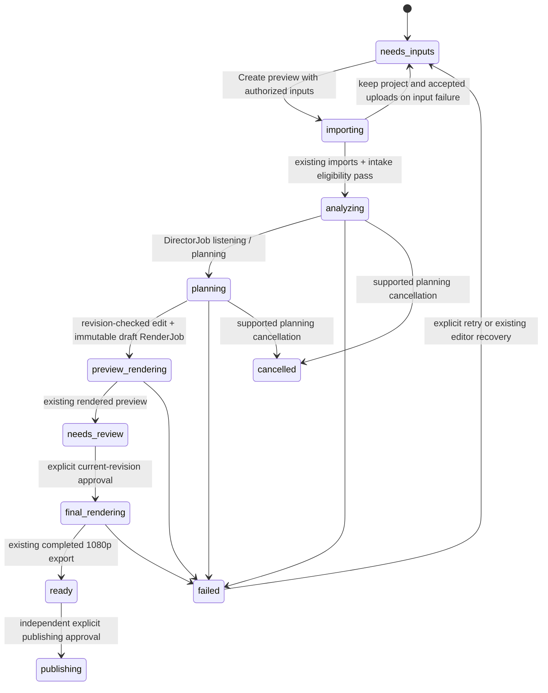

# One-Click Episode: M0 architecture decision and M1 contract

Audit completed before implementation, 2026-10-25. Scope: [Issue #5](https://github.com/wrightausername/Comic-Beatdowns/issues/5), M0/M1 only. Reviewed baseline: `main` at `a84d2bd`. Feature branch is based on main, not on an unreviewed merge.

## Dependency decision: Smart Crop PR #4

[PR #4](https://github.com/wrightausername/Comic-Beatdowns/pull/4), `feature/verdict-smart-crop-review` at `32f3a91`, remains a draft. Review and merge it separately. This PR neither merges nor copies it. Its `panel_detection.py`, `/panels/{id}/smart-crops`, `preflight.py::check_episode`, `/projects/{id}/preflight`, Smart Crop Review gallery, provider confidence, and conservative full-panel fallback remain its responsibility. M3 can consume these after review. Both branches edit `dialogs.tsx`, but this work extends `NewProject`; PR #4 extends `PanelDetail`. This work avoids its editor/gallery, panel segmentation, framing, and timeline QA modules.

## Reuse / extend / new inventory

| Area | Existing functions, components and routes | Decision / gap |
| --- | --- | --- |
| One-screen creation | `dialogs.tsx::NewProject`, `App.tsx` production entry points | Extend the existing dialog with the compact **Verdict · Auto-Director** recipe, one primary **Create preview** action, advanced settings, explicit Basic/Vision choice, and recoverable per-file state. Keep manual **New project** usable. |
| File roles | `ProductionWorkflow.tsx::guessKind`, `VerdictAutopilot.tsx::orderForProduction` | Reuse classification/order; add optional TXT/MD script support and explicit handling of unknown roles. Confirm exactly one voice recording before submission. |
| Private imports | `production.py::ingest_file`, `classify_file`, `POST /projects/{id}/import-file`, `importer.py::import_to_library` | Reuse image/PDF/CBZ and narration/SRT validation, limits, storage confinement, and provenance. Extend with UTF-8 TXT/MD script import using `remember` and `touch`; importing source wording never approves a final video. |
| Input eligibility | `project_panels`, `check_assets`, `audio_range`, `read_connection` | Add a read-only `/projects/{id}/intake-readiness` adapter for source inputs and revision/provider availability. It does not inspect scenes, detect panels, crop artwork, or replace PR #4 preflight. Surface missing/duplicate sources and optional script/SRT risks honestly. |
| Recipe and model consent | `AutopilotOptions`, `/projects/{id}/autopilot`, `/verdict/connection` | Reuse enabled/pace/mode/delivery; default to fast, draft. Basic has no visual understanding. Vision needs a saved connection and explicit authorization naming the provider; bind consent to that public connection description so a changed provider cannot inherit it. No paid credentials required. |
| Production | `DirectorService.enqueue/run`, `/projects/{id}/director`, `automation.py::build_draft` | Reuse exactly once per successful intake handoff. Keep existing queue bounds, narration/ASR/SRT processing, locks, and revision checks. No new orchestrator or crawler. |
| Preview and review | `VerdictAutopilot`, `Editor`, `ProductionWorkflow`, `Preview` | Hand back the existing project and director job. Reuse progress, preview video, captions, safe-area/loop review, locks and manual editing. No competing editor or exception queue in M1. |
| Final rendering | `queue_render_for_state`, `RenderService`, `/director/approve`, `/renders` | Unchanged: 360×640 draft, explicit revision-aware approval, then 1080×1920. Existing separately opted-in automatic-final controls remain available outside the new preview-first recipe. |
| Data and rollback | `Project`, `DirectorJob`, `RenderJob`, `ProjectVersion`, `workspace.py::locked_project/remember/snapshot/restore` | No table or migration changes. Reuse project IDs/revisions, job snapshot metadata, Undo/history, and **Before Verdict Autopilot**. |
| Brand and templates | `POST /projects`, `template_id`, `VideoSettings` | Preserve selected template, logo/music references and camera/caption/audio settings. Recording selection remains the supplied recording; 65–90 seconds is advisory. |
| Publishing | `publishing.py`, `PublishingDesk`, `/api/publishing/*` | Leave untouched. Preview creation, director approval and rendering do not upload to Cloudinary or submit to Buffer. Publishing requires its own explicit action. |
| Validation | `make check`, `make e2e`, Windows `Start Studio.cmd --check`, `.github/workflows/validate.yml` | Extend original-art/provider-mocked tests and the existing CI, including Windows media tests. Live Vision accuracy and optional voice generation are not verified or implemented here. |

## Lifecycle and contracts (before schema changes)

There are **no database schema changes**. The following is the intended end-to-end view, derived from existing persisted truth; M1 does not implement a second persisted state machine or durable M2 resume system.

- Before project creation, staged filename/type/size/voice-count checks are provisional. Actual image/archive, audio-duration, UTF-8 and SRT validation stays on the server. No claim that a filename represents recognized artwork.
- After imports and before starting Verdict, intake readiness reports the actual saved revision, recognized project panels, finite eligible narration, missing originals, provider availability, and optional script/caption warnings. Script/caption wording comparison is a text heuristic, not speech alignment or artwork understanding.
- Supplied TXT/MD is source text, not voice synthesis or final approval. A script without narration cannot start production. Caption timestamps refer to the original recording. Nothing truncates a recording to the 65–90-second target.
- Vision authorization identifies the saved endpoint/model/speech-model configuration without exposing credentials. Basic makes zero provider calls. A provider change requires renewed authorization; unusable/removed providers fail visibly without a silent downgrade.
- The new recipe always requests a draft; existing final approval and separate publishing permissions retain their contracts.

## Failure / rollback strategy

Keep one created project ID and a per-file accepted ledger for the lifetime of the open creation dialog. Disable duplicate submits synchronously. A failed import stays visible and retry skips accepted files; recover directly in the existing editor when needed. Do not delete a partially imported project or its source files automatically. Check for an already started director job before retrying a handoff whose response may have been lost. Server revision and active-job guards remain authoritative.

The director still applies a plan only if its base revision is current, preserves locked shots, saves its existing backup/version and Undo entry, and queues an immutable render snapshot. Input failures do not pretend an episode completed. Provider failure does not replace the saved edit. Cancelling planning retains the saved workspace; queued/running renders retain existing behavior. Restarted planning/render jobs use the existing interrupted-job recovery messages; they do not automatically resume or make another remote request.

This M1 dialog ledger is **not durable across a browser refresh**. The saved project/files remain in the dashboard, but durable create/start idempotency, cross-tab intake coordination, refresh resume and canonical stage presentation belong to M2. Do not claim M2 acceptance scenarios are complete.

## Explicitly deferred

- **M2:** durable orchestration/resume and idempotency across reloads; comprehensive stage mapping, cancellation and interrupted-intake recovery.
- **M3:** consume reviewed PR #4, one prioritized exception queue, linked subjective/technical findings, and revision-checked deterministic fixes with Undo. No crop or QA implementation is copied into M1.
- **M4:** streamline the existing explicit final-export handoff and measure local opt-out production effort. Existing approval/export/publishing still work; no new publishing or analytics behavior is introduced.

The M1 long-recording check exercises a real 75-second preview and source preservation. Existing short-clip tests retain real approved 1080p export coverage. Full 75-second exception-review/final-export acceptance and creative quality evaluation remain part of the later milestones. No copyrighted test assets or live paid-provider credentials are required.
